# Capsa — Brand

The mark is a box: a squared C turned on its side, with the lid lifted off in blue. The wordmark repeats the idea: each A wears the same lid.

## Files

All in [`logo/`](logo/). Vector, transparent background unless noted.

| File | Use |
|---|---|
| `capsa-lockup-on-dark.svg` / `-on-light.svg` | Primary: mark + name inline |
| `capsa-lockup-stacked-on-dark.svg` / `-on-light.svg` | Splash screen, square formats |
| `capsa-wordmark-on-dark.svg` / `-on-light.svg` | Name only |
| `capsa-mark-on-dark.svg` / `-on-light.svg` | Mark only, 24 px and up |
| `capsa-app-icon.svg` | App icon: mark on a dark rounded tile |
| `capsa-favicon-16.svg` | 16 px only: pixel-snapped mark |

## Construction

Everything sits on one unit grid. **1u = stroke width = lid thickness.**

- **One gap:** g = 0.6u. Letters are g apart, every lid floats g above the stroke below it, and the cut in the mark is g wide.
- **Glyphs:** 4u wide on a 4.6u advance, 5u cap height. Square ends, mitred corners, no rounding.
- **Centre line:** the A bar, P bowl and S middle all sit at 2.7u, so the space under the A's lid is exactly g.
- **Mark:** 5u × 5u, the same height as the letters. In the inline lockup its lid lines up with the A lids.
- **Lockups:** mark to name = 3g of the mark (inline 3g; mark-leads and stacked, where the mark is 2×, 6g of the name).
- **Clear space:** 3g on every side of the lockup.

## Sizes

- Lockup: no smaller than 14 px cap height (the app header).
- Mark: vector from 24 px up. At 16 px use `capsa-favicon-16.svg`; at that size 0.6u falls between pixels, so it uses whole-pixel strokes (3) and gaps (2).

## Colour

Only what the logo uses. The full UI palette waits until the app exists.

| Name | Hex | Use |
|---|---|---|
| Lid blue | `#4F8CFF` | The lids, nothing else in the logo |
| Ink | `#EDEDED` | Strokes on dark |
| Ground | `#0B0B0C` | Dark background; strokes on light |
| Surface | `#111113` | Cards and panels |

The lids stay blue on light backgrounds too.

## Type

For headings and UI around the logo (provisional): Michroma for headings, Inter for body, JetBrains Mono for labels and data. The logo itself is drawn, not set in a font.
